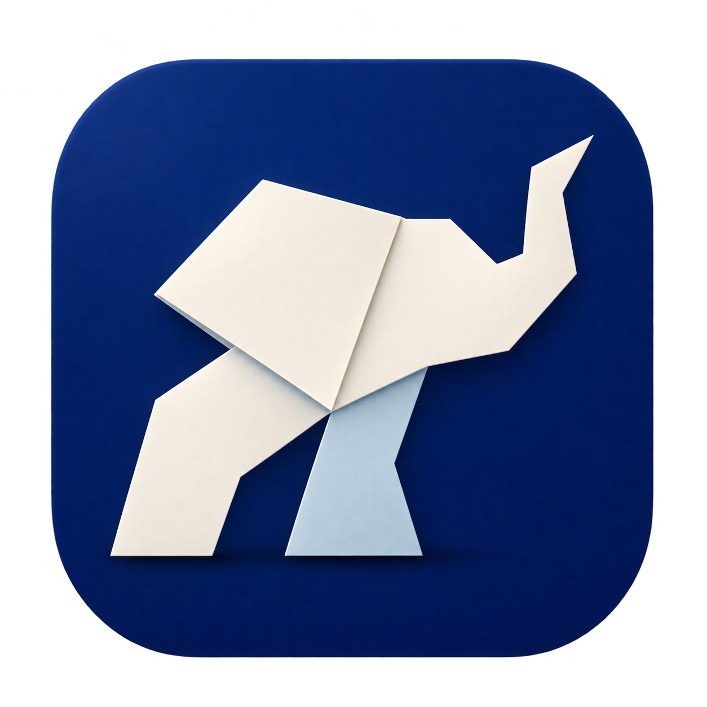

<div align="center">
  
  <h1>Trunkline</h1>
  <p>A native Mac workspace on your iPhone and iPad.</p>
</div>

Trunkline combines remote desktop, terminal sessions, files and Mac controls in a SwiftUI companion app. The Mac host bundles its desktop engine, connection transport and supervisor; users do not need to run a separate streaming application.

**Status: early development.** This is a source release for contributors and local builds, not a notarized public installer. Hardware, multi-monitor and network compatibility are still being tested. Do not depend on it as your only way to reach an unattended Mac.

## Features

- Native iPhone, iPad and Mac interfaces with light, dark and system appearance.
- Desktop streaming, direct touch, trackpad input, zoom and monitor selection.
- Named terminal sessions, file transfers, app/window controls and keep-awake settings.
- QR pairing, saved Macs and one active controlling device per host.
- Local Wi-Fi access and experimental away access using a Rust transport. Away access depends on network reachability and rendezvous infrastructure; it is not a server-free VPN or a promise to cross every NAT.

## Build and install on your Mac

Requirements: **macOS 15 or newer**, full **Xcode 26 or newer** (open it once to install components), Python 3.10+, and [Homebrew](https://brew.sh). Both Apple silicon and Intel are supported by the build recipes; this checkout has been validated on Apple silicon. Building the desktop engine downloads several dependencies and can take a while on the first run.

```sh
git clone https://github.com/Cobnex-HQ/trunkline.git
cd trunkline
./Scripts/setup-mac.sh
```

The script installs the Brewfile tools, selects Python and Rust on PATH for this build, and builds/installs Trunkline. It does not change your global Rust toolchain. For an already configured environment, use `python3 Scripts/dev.py install` directly; `python3 Scripts/dev.py doctor` checks the required tools. Xcode must be the active developer directory; a Command Line Tools-only installation is insufficient.

The install command verifies pinned downloads, compiles the engine for your Mac, builds the host with local ad-hoc signing, verifies the app bundle, and installs it at `~/Applications/Trunkline.app`. Quit an existing app at that destination before installing. The previous installation is retained as `Trunkline.previous.app`. No administrator password or developer membership is needed for this local Mac build.

Open Trunkline and complete macOS Screen Recording and Device Control and Data Access setup (called Accessibility on earlier macOS versions). macOS controls those permissions; development builds or signing changes can require approval again. Keychain access and unattended operation should be checked before relying on a newly built version.

## iPhone and iPad

```sh
python3 Scripts/dev.py ios
```

In the generated Xcode project, select the **Trunkline** scheme, your device, and **your own** signing team. For personal signing settings, copy `Config/Local.xcconfig.example` to `Config/Local.xcconfig`. The local file is ignored by Git. Use Xcode to run the app on your device. A personal team can be used for development, subject to Apple's provisioning limits; distribution is a separate process.

Start access in the Mac app, pair the companion on the same network, and verify Desktop and Terminal before trying away access. See [development](docs/DEVELOPMENT.md) and [security](SECURITY.md).

## Desktop controls

Tap the connection passcode field to open the software keyboard. The form scrolls the input into view; the eye button reveals or hides the passcode without interrupting typing. The passcode is hidden again when you leave the field.

In the desktop viewer, **Keyboard** opens the remote keyboard. In direct-touch mode, tap to click and move one finger to drag. Pinch to zoom and use two fingers to pan while zoomed in.

- Swipe **up with three fingers** for Mission Control, or **down** for App windows.
- Swipe **left or right with three fingers** to move between the Mac’s Spaces.
- The **Spaces and windows** menu offers the same actions without gestures. They use the Mac’s standard Control–Arrow shortcuts, which must be enabled on the host.
- **Displays** selects a connected physical monitor, one at a time, preserving its proportions. Spaces are virtual desktops within a monitor; create or rearrange them in Mission Control.

## Repository map

| Directory | Responsibility |
| --- | --- |
| `Apps/iOS` | Companion app, feature views, desktop client integration and design system |
| `Apps/macOS` | Host app and desktop, terminal, controls, files and power features |
| `Packages/Core` | Shared Swift protocol, identity, state and policy; independently testable |
| `Packages/Transport` | Rust transport library, helper executable and C bridge |
| `Services/DesktopSupervisor` | Small native desktop process supervisor |
| `Engines/Desktop` | Pinned upstream revision, patches and dependency/build recipes |
| `Dependencies` | Download provenance and file-integrity manifests |
| `Vendor` | Small source dependencies with their original licences |
| `Tests` | Companion, native integration and development-tool checks |
| `Scripts` | Setup, build, verification and local packaging tools |
| `Assets/Branding` | Glacier Fold vector sources and icon assets |

`project.yml` is the Xcode project source of truth. `Scripts/dev.py setup` regenerates the ignored `.xcodeproj`. Downloads, build products, credentials and personal signing settings are excluded from version control.

## Contribute

Run `python3 Scripts/dev.py test` for the shared Swift, Rust and tooling suites. See [CONTRIBUTING.md](CONTRIBUTING.md), [architecture](docs/ARCHITECTURE.md), the [test guide](docs/TESTING.md), and [validation status](docs/VALIDATION.md) for app and device checks. Please discuss large architectural changes in an issue first.

## Licence and attribution

Trunkline is distributed under [GNU GPL v3](LICENSE). Included and adapted components retain their original copyright and licence notices. The desktop and streaming integrations build on Sunshine and Moonlight; their names remain in required attribution even though the app uses Trunkline branding. SwiftTerm and MacOwl are also credited in [third-party notices](docs/THIRD_PARTY.md).

No prebuilt app or binary release is published by this repository's CI. Publishing app binaries requires the corresponding-source, dependency licence, signing and platform-distribution checks described in [RELEASING.md](docs/RELEASING.md).
